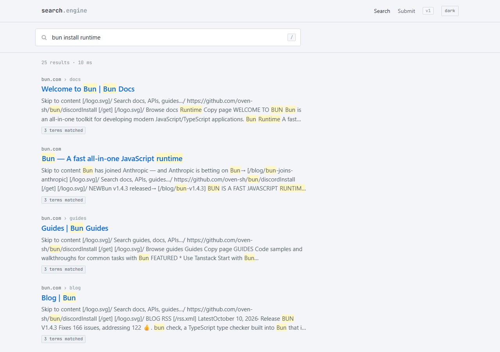
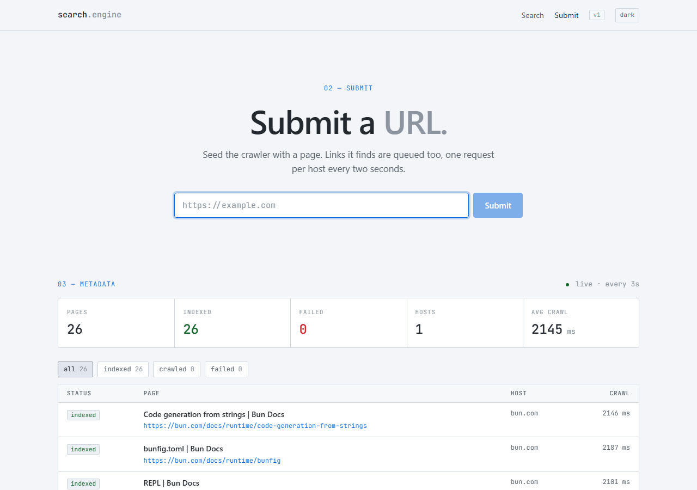

# search-engine

A small web search engine: submit a URL, it crawls outward from there, builds an inverted index, and lets you search what it found.

| Search | Submit |
| --- | --- |
|  |  |

## Structure

```
v1/       backend  — Bun + Express API, crawler and indexer (port 4000)
client/   frontend — Bun + React UI (port 3000)
```

### Backend (`v1/`)

- **Crawler** — takes URLs from a per-host queue (one request per host every 2s), saves the HTML and queues every link it finds.
- **Indexer** — turns each crawled page into tokens and adds them to an in-memory inverted index (word → pages), storing the title and a snippet.
- **State is in memory**, so it's lost when the server restarts.

| Method | Route | Description |
| --- | --- | --- |
| `POST` | `/submit-url` | `{ "url": "https://…" }` → queue a URL. `400` invalid, `409` already queued |
| `GET` | `/search?query=…` | Pages matching any query term (`url`, `title`, `snippet`) |
| `GET` | `/metadata` | Crawl status (`crawled` / `indexed` / `failed`) and timings for every page |

### Frontend (`client/`)

- **`/`** — a Google-style search page. Results are de-duplicated, ranked by how many query terms they match, and matched words are highlighted.
- **`/submit`** — submit a URL and watch it go from queued to crawled to indexed. Crawl metadata for all pages loads below, refreshing every 3s.

## Run locally

Requires [Bun](https://bun.com).

```bash
# backend
cd v1
bun install
bun run src/index.ts        # http://localhost:4000

# frontend (in a second terminal)
cd client
bun install
bun dev                     # http://localhost:3000
```

Open http://localhost:3000/submit, submit a URL, wait for a few pages to be indexed, then search from `/`.

To point the client at a different backend, set `BUN_PUBLIC_API_URL` (defaults to `http://localhost:4000`).
